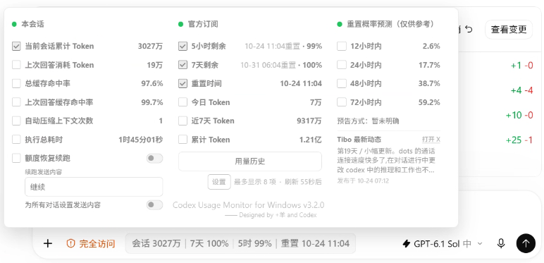
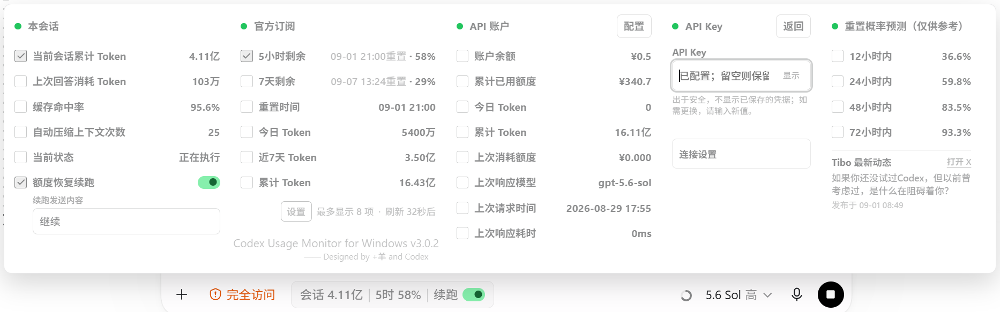
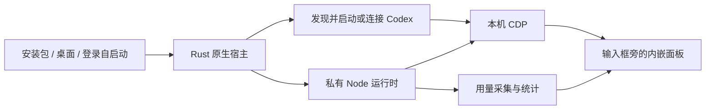

# Codex Usage Monitor · Windows Rust Edition

把 Codex Desktop 的订阅额度、会话 Token 和用量历史放到输入框旁边。

> **二次开发声明**：本项目基于 [JiaYang-BUAA/Codex-Desktop-Usage-Monitor-Windows](https://github.com/JiaYang-BUAA/Codex-Desktop-Usage-Monitor-Windows)（MIT License）二次开发，不是从零重写，也不是官方项目，与 OpenAI 没有隶属、赞助或背书关系。感谢原作者的工作。本仓库的改动范围见 [与上游的主要差异](#与上游的主要差异)，完整来源声明见 [NOTICE.md](NOTICE.md)。



主图为 v3.2.0 实际运行截图。其余示意图沿用上游项目，其中显示的用量、开关和服务配置不是新安装的默认值。

## 为什么要二次开发

我是上游项目的用户，日常使用中有两个不习惯的地方，于是做了这个分支：

1. **不喜欢 PowerShell 部署方式。** 上游通过 `install.ps1` 等 PowerShell 脚本完成安装、启动和配置，要求用户预先安装 PowerShell 7 和 Node.js 22+；日常启动依赖一个隐藏控制台窗口的专用快捷方式，隐藏 PowerShell 与 CDP 启动参数这类特征也容易引起杀毒软件误报。本仓库把原本由 PowerShell 承担的部署、启动、安装、托盘和卸载全部改为 Rust 原生实现：安装是单文件 Setup EXE，运行是一个原生 `CodexUsageMonitor.exe`，整个运行链路不再出现 PowerShell 和 VBS，Node 运行时随包附带，普通用户无需安装任何开发环境。
2. **接管 Codex 的自启动。** 上游没有开机自启动，每次开机都要先手动运行专用快捷方式，否则面板不会出现。本仓库支持"登录 Windows 时启动监视器，由监视器拉起 Codex 并自动加载面板"；启用时会识别并接管当前用户中指向 Codex 的自启动项（修改前备份，托盘可一键恢复，卸载时还原），避免 Codex 原生自启动抢先把 Codex 拉起而不开放 CDP。

需要说明的是：**这不是一次纯 Rust 重写。** 改动集中在原本由 PowerShell 承担的宿主与部署层；上游的 CDP 运行时注入、用量统计引擎和内嵌面板 JavaScript 被完整保留，由随包私有 Node 运行时执行。

## 与上游的主要差异

| 维度 | 上游原版 | 本仓库（Rust Edition） |
| --- | --- | --- |
| 安装 | 下载 ZIP 后运行 `pwsh -NoProfile -File .\install.ps1`，或 git clone 后脚本安装 | 双击 Inno Setup 单文件 `CodexUsageMonitor-Setup-<版本>-x64.exe`，当前用户安装，无需管理员权限 |
| 运行依赖 | 需自行安装 PowerShell 7 与 Node.js 22+ | 无。私有 Node 运行时随安装包分发，Rust 宿主静态链接 C 运行库 |
| 日常启动 | 必须使用专用桌面快捷方式（同时拉起 Codex 与监视器，隐藏命令行窗口） | 快捷方式或托盘启动原生 EXE；开启登录自启动后开机自动拉起 Codex 并加载面板 |
| Codex 自启动 | 不支持开机自启动 | 启用时接管当前用户 Run 项/启动文件夹中可确认指向 Codex 的自启动条目，备份后移除；托盘"恢复原 Codex 自启动"，卸载时还原 |
| 宿主与进程管理 | PowerShell 启动器 | Rust 宿主：Store/非 Store Codex 发现、CDP 端口探测与冲突回退、Node 子进程生命周期、单实例控制、系统托盘 |
| 面板与统计 | JavaScript/HTML 注入面板 | 原样保留上游实现，由随包私有 Node 执行 |
| 自动更新 | 每 24 小时检查 Release，SHA-256 校验 | 校验规则相同，且只接受含原生 EXE 的运行包，拒绝上游纯脚本包 |
| 数据目录 | `%LOCALAPPDATA%\CodexUsageMonitor` | 相同。沿用上游的状态、DPAPI entropy、凭据与 Token 账本格式 |

**保持不变的部分**：仅绑定 `127.0.0.1` 的 CDP 运行时注入原理、注入面板 UI、用量归一化与 Token 账本、历史图表、API 账户/API Key 配置、DPAPI 凭据加密、额度恢复续跑、社区重置概率预测。不修改 `WindowsApps`、`app.asar`、Codex 登录文件或模型配置。

## 功能总览

| 栏位 | 内容 | 是否需要配置 |
| --- | --- | --- |
| 本会话 | 当前会话累计 Token、上次回答消耗、总/上次缓存命中率、自动压缩次数、执行耗时。 | 不需要。 |
| 官方订阅 | 5 小时/7 天额度、重置时间，以及今日、近 7 天、累计 Token。 | 使用 Codex 已登录的官方订阅，无需额外凭据。 |
| 用量历史 | 今日/7 天/30 天 Token 图和已采集的额度剩余曲线。 | 随本机采集逐步积累。 |
| API 账户 | 第三方账户余额、累计已用额度、请求记录和 Token 账本。 | 按需配置，默认隐藏。 |
| API Key | 某个 Key 的已用额度、限额、到期时间和请求状态。 | 按需配置，默认隐藏。 |
| 重置概率预测 | 第三方社区预测、重置预告及 Tibo 最新公开动态摘要。 | 无需凭据，可隐藏；不是官方承诺。 |

统计口径注意：

- 本机 Token、历史图表不等于跨设备的完整账单；首次启用不保证已有完整历史。
- 缺失额度快照不补成 0%，也不根据 Token 推算额度；Pro 等套餐可能没有可展示的 5 小时主额度。
- "上次回答"在回答结束后更新；请求失败时保留上次成功值，红灯不等于额度耗尽。

详细字段、账本算法和 Provider 映射见 [数据源与指标说明](docs/data-sources.md)。

## 快速开始

### 运行要求

- Windows 10 2004 或更新版本、Windows 11，x64。
- 已安装完整的 Codex Desktop，并能够正常登录。兼容 Microsoft Store 和常见非 Store 安装。
- 普通用户无需安装 Rust、Node.js、PowerShell 7 或 Visual Studio。

当前已在 Windows 11 的 Store 版 Codex 上验证 CDP 连接、监视栏显示和官方订阅/会话用量。其他 Codex 版本仍可能存在页面结构或内部协议差异。

### 安装

1. 在本仓库的 **Releases** 中下载 `CodexUsageMonitor-Setup-<版本>-x64.exe`。
2. 双击安装，按需勾选"登录 Windows 时启动工具"。默认安装到当前用户目录，不要求管理员权限。
3. 保持完成页的"立即启动"勾选，点击完成。

安装包自带私有 Node 运行时，安装过程不需要在线下载运行依赖。安装器会自动查找 Codex；找不到时才询问真实的 `ChatGPT.exe` 或官方 `codex.exe`。官方订阅无需 API Key。

| Codex 当前状态 | 安装后启动工具的行为 |
| --- | --- |
| 未运行 | 启动 Codex，开放仅限本机的连接端口，然后自动加载监视栏。 |
| 已开放 CDP | 直接连接现有会话，无需重启 Codex。 |
| 已运行但没有开放 CDP | 提示你正常退出 Codex，再使用新快捷方式；不会强制结束会话。 |

**首次安装不保证能接管一个已经运行、且没有开放 CDP 的 Codex。**这个限制来自运行时注入方式本身，安装器不会通过修改 Codex 程序或强制重启来绕过它。

### 日常启动

使用桌面或开始菜单中的 **Codex Usage Monitor**。开启登录自启动后，登录 Windows 会自动启动工具，并由工具打开 Codex。

原生 Codex 图标仍保留；从它启动通常不会开放 CDP。建议把新的工具入口固定到任务栏作为日常入口。

### 自启动接管的边界

启用自启动时，只移除当前用户 Run 项或启动文件夹中**可确认指向所发现 Codex EXE** 的条目，修改前备份到 `%LOCALAPPDATA%\CodexUsageMonitor\codex-startup-backup.json` 和 `startup-backup`。不会按名称模糊删除其他软件，不修改机器级启动项，也不写 Windows 未公开的 StartupApproved 二进制状态。

若你的 Codex 使用 Store StartupTask 或机器级自启动，请在 Windows"启动应用"中手动关闭 Codex 原生项。托盘的"恢复原 Codex 自启动"只恢复本工具实际备份的条目，不覆盖你后来设置的新条目。

命令行管理：

```text
CodexUsageMonitor.exe --diagnose
CodexUsageMonitor.exe --install --enable-autostart
CodexUsageMonitor.exe --disable-autostart
CodexUsageMonitor.exe --restore-codex-startup
```

`--diagnose` 只输出路径、自启动状态和 CDP 端口，不读取或返回凭据。

## 面板与设置

点击折叠监视栏展开面板，在"官方订阅 → 设置"中调整显示项：

- 普通模式最多选择 8 项；极简模式最多 14 项，较多指标自动分成两行。
- 支持中文、English UI、刷新倒计时；默认用量轮询 60 秒，可切换 30 秒刷新。
- 勾选"5小时重置"可在监视栏显示本机时区的重置时刻，例如"5时重置 14:30"。
- ChatGPT 普通聊天模式不挂载；Codex 任务和 ChatGPT Work 工作模式继续显示。


极简模式把更多指标压缩进监视栏，较多项自动分成两行：


托盘菜单提供：打开 Codex、重新连接监视器、启停登录自启动、打开数据目录、恢复原 Codex 自启动、退出监视器。退出工具不会关闭 Codex。

### 可选：API 账户与 API Key

先在设置里打开"API 栏"，再点击对应标题旁的"配置"。



| 来源 | 需要填写 |
| --- | --- |
| API 账户 | Base URL、数字用户 ID、账户访问令牌、真实累计 Token 基准。 |
| API Key | Key、服务地址、用量接口路径；特殊响应通过高级字段映射适配。 |

账户访问令牌不一定等于 API Key，接口也不是所有服务商都兼容，请以服务商公开文档为准。累计 Token 基准必须是完整非负整数，不知道精确值时可填 `0`，之后从已采集日志累计。

**密钥只填写在本机配置表单中，不要提交到聊天、Git、JSON 配置或日志。**持久化凭据由 Windows 当前用户 DPAPI 加密；表单不会回填密钥，留空可保留原密钥。

### 可选：额度恢复续跑

该功能默认关闭，按任务独立启用。仅在任务明确因官方额度耗尽暂停、且更新的官方额度确认恢复时，向原任务发送续跑内容。默认文案为"继续"，支持按对话或统一设置。

社区预测不会触发续跑。续跑是正常的新回合，会消耗额度；它不占用可见输入框，不覆盖排队消息。

## 安装、数据与卸载

| 位置 | 用途 |
| --- | --- |
| `%LOCALAPPDATA%\Programs\CodexUsageMonitor` | 原生入口、当前版本指针和独立的版本运行目录。 |
| `%LOCALAPPDATA%\CodexUsageMonitor` | UI 设置、用量历史、Token 账本、DPAPI 凭据及运行状态。 |
| 桌面/开始菜单 | 直接指向 `CodexUsageMonitor.exe` 的快捷方式，使用内嵌图标。 |

重新安装保留数据目录，不重置累计或每日 Token。

### 卸载

在 **Windows 设置 → 应用 → 已安装的应用 → Codex Usage Monitor (Rust) → 卸载**。

卸载会退出监视器、移除原生程序与快捷方式、关闭工具的自启动，并恢复本工具实际备份的 Codex 自启动项。不会卸载或关闭 Codex。默认保留配置、加密凭据和用量记录。

如果希望清除个人数据，可在卸载完成后手动删除 `%LOCALAPPDATA%\CodexUsageMonitor`。这会删除 Token 账本与密钥，无法靠重新安装恢复。

## 工作方式



- **Rust**：Store/非 Store 发现、进程生命周期、端口探测、托盘、DPAPI、安装、自启动和卸载。
- **JavaScript**：复用上游的 CDP 注入、用量归一化、Token 账本、历史图表、面板和续跑逻辑。
- **Inno Setup**：生成单个 Windows 安装 EXE，释放白名单运行包并调用 Rust 安装器；运行时不调用 PowerShell 或 VBS。

它不是 Codex 官方插件，也不是纯 Rust 重写。宿主和统计进程在本机运行，面板通过 CDP 加入 Codex 页面，不修改 `WindowsApps`、`app.asar`、Codex 登录文件或模型配置。

源码入口与生命周期见 [架构说明](docs/architecture.md)，原生版细节见 [Windows 原生版说明](docs/native-windows.md)。

## 安全与网络边界

- CDP 仅使用 `127.0.0.1`，保留端口冲突回退和单实例控制。
- 官方订阅通过本机官方 CLI/app-server 获取；Store CLI 先复制到用户目录的镜像再执行，绝不直接执行 `WindowsApps` 内的 CLI。
- 项目不直接读取 `.codex/auth.json` 或 `config.toml` 获取凭据；官方 CLI 自身按其正常登录机制工作。
- API 凭据使用 DPAPI；携带凭据的远程请求要求 HTTPS，只有回环地址允许 HTTP；拒绝重定向并限制响应体。
- 社区预测每 5 分钟请求 `https://codex.gussuriworks.com/api/current?locale=zh`，不发送登录凭据、对话内容、Token 数据或任务 ID。
- 发布包不包含 Codex 本体、用户配置、API 凭据、个人日志或账本；Node 与 Rust 依赖许可随包附带。

当前安装包未做代码签名，发布时请附 SHA-256 校验文件；不要把关闭安全防护作为安装步骤。

## 更新与已知限制

自动更新默认由用户选择开启，最多每天检查一次，只接受更高版本的正式 Release、精确包名和 GitHub SHA-256 摘要，验证安全解压边界后才安装。失败继续运行当前版本，不重启 Codex。

自动更新源已指向本仓库 `hadesgeek/Codex-Usage-Monitor-for-Windows-Rust` 的 Releases。只有在本仓库发布包含 `codex-usage-monitor-windows-<版本>.zip` 资产和 GitHub SHA-256 摘要的正式 Release 后，已安装版本才会检测到更新；在此之前请手动下载安装包。如果你进一步分叉本仓库，需按 [发布指南](docs/publishing.md) 同步修改 `scripts/auto-updater.mjs` 中的更新源与 `tests/auto-updater.mjs` 内的测试地址。原生版只接受含原生 EXE 的运行包，拒绝纯脚本包。

| 现象 | 处理 |
| --- | --- |
| 工具已运行但没有监视栏 | 查看托盘状态；已有 Codex 未开放 CDP 时，正常退出后用新入口启动。 |
| 显示已连接但没有订阅数据 | 先确认 Codex 官方账户已登录；等待刷新。配置 API Key 不能修复官方订阅登录。 |
| API 显示未配置或请求受限 | 在展开面板配置对应来源；HTTP 429 会退避，不必反复保存或重启。 |
| 社区预测红灯/过期 | 属于第三方数据状态，不影响官方订阅和本会话统计。 |
| Codex 更新后位置或数据异常 | 可能是页面或内部协议变化，提交脱敏复现信息；不要上传密钥或完整私人响应。 |

更多排查项见 [故障排除](docs/troubleshooting.md)。

## 开发与构建

开发需要 Rust MSVC 工具链、Windows SDK、Inno Setup 6，以及与 `runtime/node-version.txt` 一致的 Node.js。Rust 宿主使用静态 C 运行库；普通用户不需要开发环境。

```text
npm ci
cargo test --locked --manifest-path native/Cargo.toml
cargo clippy --locked --manifest-path native/Cargo.toml --all-targets -- -D warnings
node tests/native-host.mjs
npm test

# 生成运行 ZIP、Setup EXE 和校验文件，并运行隔离安装/卸载验证
npm run build
```

产物位于 `dist/release/`。如果编译器不在常见位置，可设置 `ISCC_PATH` 为真实的 `ISCC.exe` 路径。构建不要求本机已安装 Codex，真实连接与界面仍需单独验证。

此源码仓库只保留 Rust 原生版与 Node.js 统计、配置和面板代码；不包含旧版 PowerShell/VBS 安装、启动或配置脚本，构建与测试统一通过 Node.js 和 Cargo 入口执行。发布自己的 Release 的完整步骤见 [发布指南](docs/publishing.md)。

## 许可与致谢

采用 [MIT License](LICENSE)。

- 上游项目：[JiaYang-BUAA/Codex-Desktop-Usage-Monitor-Windows](https://github.com/JiaYang-BUAA/Codex-Desktop-Usage-Monitor-Windows) —— 本仓库的统计引擎、注入面板与运行时注入思路均由此而来。
- 注入思路的更早来源：[Fei-Away/Codex-Dream-Skin](https://github.com/Fei-Away/Codex-Dream-Skin)、[tree0519/Codex-Dream-Skin-Forge](https://github.com/tree0519/Codex-Dream-Skin-Forge)。
- 重置概率预测数据来自 [Codex Reset Observatory](https://github.com/gussuri/codex-reset-observatory)，其数据不代表 OpenAI 承诺。

完整声明见 [NOTICE.md](NOTICE.md)。Codex 与 OpenAI 是其各自所有者的商标；本项目为非官方项目，与 OpenAI 无隶属、赞助或背书关系。
